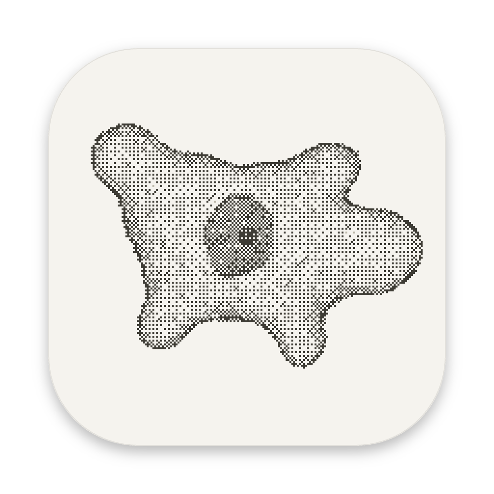
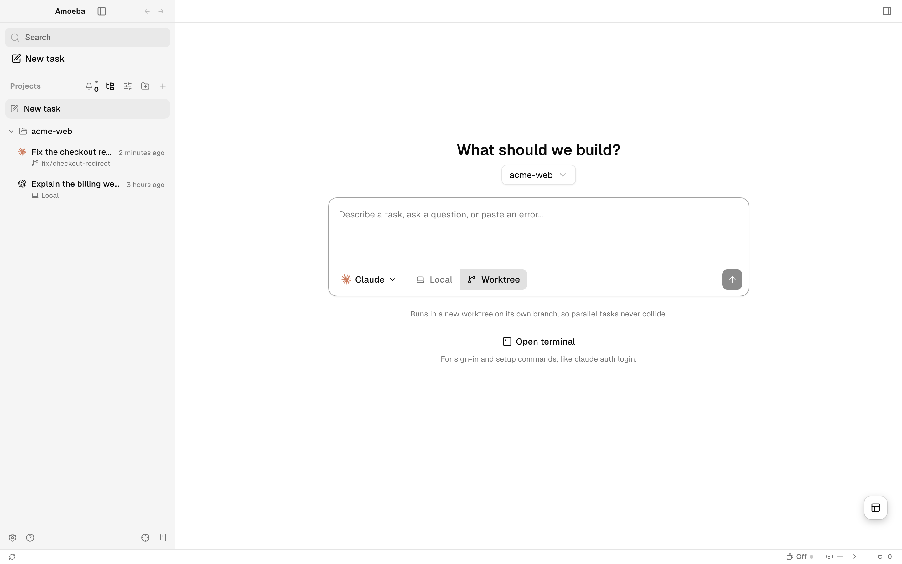
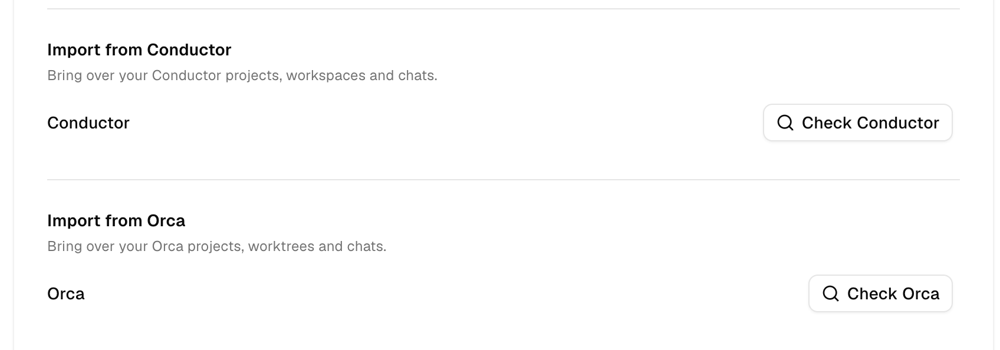

<h1 align="center">
  <a href="https://www.amoeba.sh"></a> Amoeba
</h1>

<p align="center">
  <strong>A chat-first desktop app for running coding agents side by side.</strong><br/>
  Every task is a conversation with Claude, Codex or another agent, in your project folder or its own git worktree.
</p>

<p align="center">
  <a href="https://www.amoeba.sh">amoeba.sh</a> · <a href="https://www.amoeba.sh/docs">Docs</a> · <a href="https://www.amoeba.sh/changelog">Changelog</a>
</p>

<p align="center">
  
</p>

## What it does

- **Projects and tasks.** The sidebar lists your projects and, under each, its tasks: one row per workspace, newest activity first.
- **Chat first.** Claude and Codex run in a native chat view with streamed replies, tool activity, approvals and subagent progress. Tabs in a workspace stay in that workspace.
- **Local or Worktree.** Run a task in your project folder, or give it its own git worktree and branch so parallel agents never collide. Worktrees live in `~/amoeba/workspaces`.
- **A terminal when you need one.** Open a shell docked under any chat, or one in your home folder for sign-in commands like `claude auth login`.
- **Built-in browser.** Preview your app next to the chat and hand page elements straight to an agent.
- **Review the diff.** Comment on an agent's changes and send the notes back to it.
- **Bring your history.** Settings → General imports projects, worktrees and chats from Conductor or Orca. Nothing comes over until you ask, and the other app is never changed.
- **Scriptable.** The `amoeba` command creates worktrees, launches agents and drives terminals and the browser; agents use it too.

<p align="center">
  
</p>

## Agents

Claude Code and Codex open in the chat view. More than thirty other CLI agents (Gemini, Cursor, GitHub Copilot, OpenCode, Amp, Goose, Kimi and others) run in a terminal. Each agent signs in with your own account. See [supported agents](https://www.amoeba.sh/docs/agents/supported).

## Build and run

Amoeba builds from source on macOS, Linux and Windows. You need Node and pnpm.

```bash
pnpm install
pnpm dev                 # run from source
pnpm install:mac:local   # macOS: build and install /Applications/Amoeba.app
```

See [CONTRIBUTING.md](.github/CONTRIBUTING.md) for the development workflow and checks.

## Credits

Amoeba is a fork of [Orca](https://github.com/stablyai/orca) by Stably. It keeps its own data folders, so Amoeba and Orca can run on the same machine.

## License

[MIT](LICENSE)
